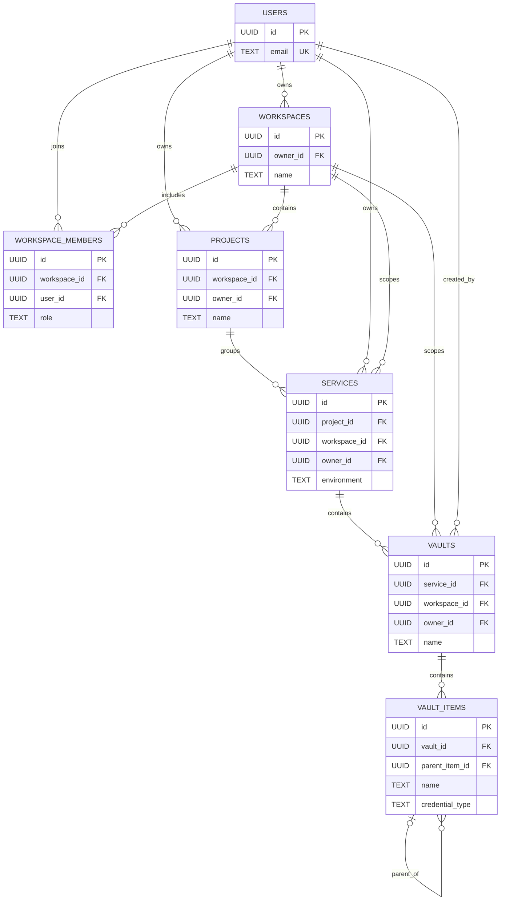

# Vaultnary Database and ER-Model Guide

## 1. Scope and source

This guide explains the relational schema represented by the repository's PostgreSQL migrations `000` through `018`. It covers the 18 application tables, their attributes and keys, relationships, constraints, indexes, the SQL function, and the conversion from an ER model to relational tables.

- [`database_schema.sql`](./database_schema.sql) contains the consolidated, commented migration SQL.
- [`database_queries.sql`](./database_queries.sql) contains read-only examples for inspecting application data.
- This is a source-code-based description, not a dump of a live database. No SQL was executed to create this guide.
- The `_sqlx_migrations` table is included in the schema SQL for migration bookkeeping; it is not an application/business entity.

The main product hierarchy is:

**Workspace → Project → Service → Vault → Credential**

Users may belong to workspaces, and credential hierarchy is an optional parent/child structure inside a vault.

## 2. Visual ER model

These are Crow's-foot ER diagrams. Table boxes show the most important identifiers and relationship attributes; Section 3 lists every column with its type and meaning.

Inside a box, `PK` marks a primary-key attribute, `FK` a foreign-key attribute, and `UK` an alternate unique key. A key can serve more than one role; for example, `VAULT_KEY_MATERIAL.user_id` is both the row's PK and a reference to its user.

| Symbol | Meaning |
|---|---|
| `||` | Exactly one (required). |
| `o|` | Zero or one (optional). |
| `|{` | One or more. |
| `o{` | Zero or many. |

Read each line from left to right. For example, `WORKSPACES ||--o{ PROJECTS` means a project belongs to exactly one workspace, while a workspace can contain zero or many projects.

### 2.1 Workspace-to-credential hierarchy

`vaults` has a composite foreign key `(service_id, workspace_id)` to `services (id, workspace_id)`. This is why the service and workspace columns both appear in the vault box: the database requires the selected service to belong to the same workspace as the vault.

### 2.2 Credential usage, access, and account support

```mermaid
erDiagram
    USERS {
        UUID id PK
        TEXT email UK
    }
    VAULT_ITEMS {
        UUID id PK
        UUID vault_id FK
        TEXT name
        TEXT credential_type
    }
    PROJECTS {
        UUID id PK
        UUID workspace_id FK
        TEXT name
    }
    SERVICES {
        UUID id PK
        UUID project_id FK
        UUID workspace_id FK
        TEXT name
    }
    CREDENTIAL_USAGE {
        UUID id PK
        UUID item_id FK
        UUID project_id FK
        UUID service_id FK
        TEXT environment
    }
    CREDENTIAL_PERMISSIONS {
        UUID id PK
        UUID item_id FK
        UUID user_id FK
        TEXT role
    }
    SHARE_INVITATIONS {
        UUID id PK
        UUID item_id FK
        UUID inviter_id FK
        TEXT invitee_email
        TEXT state
    }
    CREDENTIAL_KEY_ENVELOPES {
        UUID id PK
        UUID item_id FK
        UUID user_id FK
        BYTEA encrypted_dek
    }
    USER_PUBLIC_KEYS {
        UUID id PK
        UUID user_id FK
        TEXT fingerprint UK
    }
    RECOVERY_MATERIAL {
        UUID id PK
        UUID user_id FK
    }
    VAULT_KEY_MATERIAL {
        UUID user_id PK
    }
    AUTH_SESSIONS {
        UUID id PK
        UUID user_id FK
        TIMESTAMPTZ expires_at
    }
    AUDIT_EVENTS {
        UUID id PK
        UUID actor_id FK
        UUID resource_id
        TEXT action_type
    }
    ACCOUNT_REQUEST_METRICS {
        UUID user_id PK
        TIMESTAMPTZ bucket_start PK
        BIGINT read_requests
    }
    EMAIL_OUTBOX {
        UUID id PK
        TEXT recipient_email
        TIMESTAMPTZ available_at
        INTEGER attempts
    }

    VAULT_ITEMS ||--o{ CREDENTIAL_USAGE : has_context
    PROJECTS o|--o{ CREDENTIAL_USAGE : project_context
    SERVICES o|--o{ CREDENTIAL_USAGE : service_context
    USERS ||--o{ CREDENTIAL_PERMISSIONS : receives
    VAULT_ITEMS ||--o{ CREDENTIAL_PERMISSIONS : has_access_rules
    USERS ||--o{ SHARE_INVITATIONS : sends
    VAULT_ITEMS ||--o{ SHARE_INVITATIONS : invited_for
    USERS ||--o{ CREDENTIAL_KEY_ENVELOPES : receives
    VAULT_ITEMS ||--o{ CREDENTIAL_KEY_ENVELOPES : has_envelopes
    USERS ||--o{ USER_PUBLIC_KEYS : registers
    USERS ||--o| RECOVERY_MATERIAL : has
    USERS ||--o| VAULT_KEY_MATERIAL : has
    USERS ||--o{ AUTH_SESSIONS : signs_in_with
    USERS ||--o{ ACCOUNT_REQUEST_METRICS : measured_by
    USERS o|--o{ AUDIT_EVENTS : acts_in
```

In the diagram, `VAULT_KEY_MATERIAL.user_id` is both the primary key and a foreign key to `USERS.id`; the connector shows the relationship, and Section 3 describes the dual key role. `ACCOUNT_REQUEST_METRICS` uses the composite primary key `(user_id, bucket_start)`. `CREDENTIAL_USAGE` must reference a credential and at least one of a project or service; it may reference both.

`EMAIL_OUTBOX` and `_sqlx_migrations` are operational tables rather than product entities. `AUDIT_EVENTS.resource_id` is intentionally polymorphic: `resource_type` tells which kind of object it refers to, so it is not a foreign key to one specific table.

## 3. Table and attribute catalog

`PK` means primary key, `FK` means foreign key, `UQ` means unique key/index, and `NN` means `NOT NULL`. Unless noted otherwise, timestamps are `TIMESTAMPTZ`, UUIDs default to `gen_random_uuid()` where an ID is generated, and foreign keys use the delete behavior listed in Section 6.

### 3.1 Accounts and sessions

#### `users` — account identity

| Attribute | Type / key | Meaning |
|---|---|---|
| `id` | UUID, PK | Account identifier. |
| `email` | TEXT, NN, UQ | Login/contact email; alternate candidate key. |
| `password_hash` | TEXT, NN | Password verifier; not the original password. |
| `email_verified` | BOOLEAN, NN, default `false` | Whether the email address has been verified. |
| `email_verify_token_hash` | TEXT | Hash of the email-verification token. |
| `email_verify_token_expires_at` | TIMESTAMPTZ | Expiration time for that token. |
| `password_reset_token_hash` | TEXT | Hash of the password-reset token. |
| `password_reset_token_expires_at` | TIMESTAMPTZ | Expiration time for that token. |
| `password_change_required` | BOOLEAN, NN, default `false` | Whether the account must change its password. |
| `created_at` | TIMESTAMPTZ, NN | Account creation time. |
| `updated_at` | TIMESTAMPTZ, NN | Last account-record update time. |

#### `auth_sessions` — active and historical sign-in sessions

| Attribute | Type / key | Meaning |
|---|---|---|
| `id` | UUID, PK | Session identifier. |
| `user_id` | UUID, FK → `users.id`, NN | Account that owns the session. |
| `token_hash` | TEXT, NN, UQ | Unique stored hash used to look up the session. |
| `csrf_token_hash` | TEXT, NN | Stored hash of the session's CSRF token. |
| `ip_address` | INET | Optional client IP address. |
| `user_agent` | TEXT | Optional browser/device description. |
| `device_fingerprint` | TEXT, max 512 characters | Optional device identifier. |
| `last_used_at` | TIMESTAMPTZ | Most recent use, when recorded. |
| `expires_at` | TIMESTAMPTZ, NN | Session expiration time. |
| `revoked` | BOOLEAN, NN, default `false` | Whether the session was invalidated early. |
| `created_at` | TIMESTAMPTZ, NN | Session creation time. |

### 3.2 Workspace and service hierarchy

#### `workspaces` — top-level team/personal container

| Attribute | Type / key | Meaning |
|---|---|---|
| `id` | UUID, PK | Workspace identifier. |
| `name` | TEXT, NN, 1–100 characters | Display name. |
| `owner_id` | UUID, FK → `users.id`, NN | Workspace owner. |
| `created_at` | TIMESTAMPTZ, NN | Creation time. |
| `updated_at` | TIMESTAMPTZ, NN | Last update time. |

#### `workspace_members` — user/workspace membership junction

| Attribute | Type / key | Meaning |
|---|---|---|
| `id` | UUID, PK | Membership row identifier. |
| `workspace_id` | UUID, FK → `workspaces.id`, NN | Workspace joined. |
| `user_id` | UUID, FK → `users.id`, NN | Member account. |
| `role` | TEXT, NN; CHECK | `owner`, `admin`, `editor`, or `viewer`. |
| `created_at` | TIMESTAMPTZ, NN | Membership creation time. |
| `(workspace_id, user_id)` | UQ | Prevents the same account being added twice to one workspace. |

#### `projects` — grouping of related work

| Attribute | Type / key | Meaning |
|---|---|---|
| `id` | UUID, PK | Project identifier. |
| `owner_id` | UUID, FK → `users.id`, NN | User who owns/created the project. |
| `name` | TEXT, NN, 1–100 characters | Project name. |
| `description` | TEXT, max 500 characters | Optional description. |
| `created_at` | TIMESTAMPTZ, NN | Creation time. |
| `workspace_id` | UUID, FK → `workspaces.id`, NN | Workspace containing the project. |
| `updated_at` | TIMESTAMPTZ, NN | Last update time. |

#### `services` — deployable/application component within a project

| Attribute | Type / key | Meaning |
|---|---|---|
| `id` | UUID, PK | Service identifier. |
| `project_id` | UUID, FK → `projects.id`, NN in final migration state | Project containing the service. |
| `owner_id` | UUID, FK → `users.id`, NN | User who owns/created the service. |
| `name` | TEXT, NN, 1–100 characters | Service name. |
| `description` | TEXT, max 500 characters | Optional description. |
| `environment` | TEXT, NN; CHECK | `development`, `staging`, `production`, or `custom`. |
| `created_at` | TIMESTAMPTZ, NN | Creation time. |
| `workspace_id` | UUID, FK → `workspaces.id`, NN | Workspace containing the service. |
| `updated_at` | TIMESTAMPTZ, NN | Last update time. |
| `(id, workspace_id)` | UQ | Composite unique key required as the target of the vault composite FK. Since `id` alone is already a PK, this is a superkey but not a minimal candidate key. |

#### `vaults` — credential container owned by a service

| Attribute | Type / key | Meaning |
|---|---|---|
| `id` | UUID, PK | Vault identifier. |
| `owner_id` | UUID, FK → `users.id`, NN | Creator/owner retained for account operations. |
| `name` | TEXT, NN, default `Default Vault` | Display name. |
| `created_at` | TIMESTAMPTZ, NN | Creation time. |
| `workspace_id` | UUID, FK → `workspaces.id`, NN | Workspace containing the vault. |
| `service_id` | UUID, part of composite FK, NN | Owning service; paired with `workspace_id` to enforce same-workspace ownership. |

The final schema does **not** make `vaults.workspace_id` unique. The earlier unique index was removed when vaults became service-owned.

### 3.3 Credentials and access

#### `vault_items` — credential records and optional hierarchy nodes

| Attribute | Type / key | Meaning |
|---|---|---|
| `id` | UUID, PK | Credential identifier. |
| `vault_id` | UUID, FK → `vaults.id`, NN | Vault containing the credential. |
| `parent_item_id` | UUID, self-FK → `vault_items.id` | Optional parent credential. |
| `name` | TEXT, NN, 1–255 characters | Credential display name. |
| `credential_type` | TEXT, NN; CHECK | `email`, `website`, `database`, `api_key`, `token`, `ssh`, `service_account`, `totp`, `recovery_code`, or `custom`. |
| `encrypted_payload` | BYTEA | Encrypted credential values. |
| `tags` | TEXT[], NN, default empty array | Searchable labels. |
| `notes` | TEXT, max 10,000 characters | Optional free-form notes. |
| `is_favorite` | BOOLEAN, NN, default `false` | Legacy favorite attribute retained on the credential. |
| `last_accessed_at` | TIMESTAMPTZ | Last access time, when recorded. |
| `created_at` | TIMESTAMPTZ, NN | Creation time. |
| `updated_at` | TIMESTAMPTZ, NN | Last update time. |
| `payload_metadata` | JSONB | Structured metadata associated with the payload. |
| `encrypted_metadata` | BYTEA | Encrypted credential metadata. |

#### `credential_usage` — association between a credential and its work context

| Attribute | Type / key | Meaning |
|---|---|---|
| `id` | UUID, PK | Usage-association identifier. |
| `item_id` | UUID, FK → `vault_items.id`, NN | Credential being used. |
| `project_id` | UUID, FK → `projects.id` | Optional project context. |
| `service_id` | UUID, FK → `services.id` | Optional service context. |
| `environment` | TEXT, max 50 characters | Optional use-specific environment label. |
| `notes` | TEXT, max 500 characters | Optional explanation of the usage. |
| `created_at` | TIMESTAMPTZ, NN | Association creation time. |

At least one of `project_id` or `service_id` must be populated. Partial unique indexes prevent duplicate `(item_id, project_id)` and `(item_id, service_id)` associations when the respective target is present.

#### `credential_permissions` — user access to an individual credential

| Attribute | Type / key | Meaning |
|---|---|---|
| `id` | UUID, PK | Permission-row identifier. |
| `item_id` | UUID, FK → `vault_items.id`, NN | Credential receiving access control. |
| `user_id` | UUID, FK → `users.id`, NN | User receiving access. |
| `role` | TEXT, NN; CHECK | `owner`, `co_owner`, `editor`, or `viewer`. |
| `granted_at` | TIMESTAMPTZ, NN | Original grant time, retained for compatibility. |
| `is_favorite` | BOOLEAN, NN, default `false` | Per-user favorite flag. |
| `created_at` | TIMESTAMPTZ, NN | Timestamp used by current application queries. |
| `(item_id, user_id)` | UQ | One permission per user/credential pair. |

#### `share_invitations` — pending or completed credential-share requests

| Attribute | Type / key | Meaning |
|---|---|---|
| `id` | UUID, PK | Invitation identifier. |
| `item_id` | UUID, FK → `vault_items.id`, NN | Credential being shared. |
| `inviter_id` | UUID, FK → `users.id`, NN | Account that sent the invitation. |
| `invitee_email` | TEXT, NN | Email address receiving the invitation; it is not an FK to `users`. |
| `role` | TEXT, NN; CHECK | `co_owner`, `editor`, or `viewer`. |
| `state` | TEXT, NN, default `pending`; CHECK | `pending`, `accepted`, `declined`, `expired`, or `revoked`. |
| `expires_at` | TIMESTAMPTZ, NN | Invitation expiration time. |
| `created_at` | TIMESTAMPTZ, NN | Invitation creation time. |

**Known mismatch:** API accept/decline/revoke queries write `share_invitations.updated_at`, but no migration defines that column. The schema SQL and this catalog intentionally reflect the migration-defined columns and do not silently add it.

#### `credential_key_envelopes` — per-user encrypted key for a credential

| Attribute | Type / key | Meaning |
|---|---|---|
| `id` | UUID, PK | Envelope-row identifier. |
| `item_id` | UUID, FK → `vault_items.id`, NN | Credential associated with the encrypted key. |
| `user_id` | UUID, FK → `users.id`, NN | User who can use the envelope. |
| `encrypted_dek` | BYTEA, NN | Encrypted data-encryption key. |
| `key_fingerprint` | TEXT | Optional public-key fingerprint. |
| `algorithm` | TEXT | Optional algorithm label. |
| `created_at` | TIMESTAMPTZ, NN | Envelope creation time. |
| `(item_id, user_id)` | UQ | At most one key envelope per credential/user pair. |

#### `user_public_keys` — public keys registered by users

| Attribute | Type / key | Meaning |
|---|---|---|
| `id` | UUID, PK | Public-key row identifier. |
| `user_id` | UUID, FK → `users.id`, NN | Account that registered the key. |
| `public_key` | TEXT, NN | Public key material. |
| `fingerprint` | TEXT, NN, UQ | Unique key fingerprint; alternate candidate key. |
| `created_at` | TIMESTAMPTZ, NN | Registration time. |

#### `recovery_material` — account recovery record

| Attribute | Type / key | Meaning |
|---|---|---|
| `id` | UUID, PK | Recovery-record identifier. |
| `user_id` | UUID, FK → `users.id`, NN, UQ | One recovery record per account. |
| `encrypted_private_key` | BYTEA, NN | Encrypted private-key backup. |
| `integrity_tag` | BYTEA, NN | Integrity check value. |
| `kdf_params` | JSONB, NN | Key-derivation parameters. |
| `created_at` | TIMESTAMPTZ, NN | Record creation time. |

### 3.4 Activity and operations

#### `audit_events` — activity history

| Attribute | Type / key | Meaning |
|---|---|---|
| `id` | UUID, PK | Event identifier. |
| `actor_id` | UUID, FK → `users.id` | User who performed the action; set to NULL if that user is deleted. |
| `action_type` | TEXT, NN; CHECK | Application action such as user/session/item/invitation/permission/export/import activity. |
| `resource_id` | UUID | Optional ID of the affected object; deliberately not an FK because resources have different tables. |
| `resource_type` | TEXT | Optional label identifying the resource kind. |
| `ip_address` | INET | Optional client IP address. |
| `metadata` | JSONB, NN, default `{}` | Additional structured event details. |
| `created_at` | TIMESTAMPTZ, NN | Event time. |

The final check constraint includes `export.initiated` and `import.initiated`, added by migration 013. The application treats the table as append-only; a database role can be restricted to SELECT/INSERT. Account deletion has a dedicated purge function, so “append-only” is not an absolute prohibition on all deletion.

#### `email_outbox` — emails awaiting delivery or retry

| Attribute | Type / key | Meaning |
|---|---|---|
| `id` | UUID, PK | Queued-email identifier. |
| `recipient_email` | TEXT, NN | Destination address. |
| `subject` | TEXT, NN | Email subject. |
| `html_body` | TEXT, NN | Rendered message body. |
| `attempts` | INTEGER, NN, default `0`; CHECK ≥ 0 | Number of delivery attempts. |
| `available_at` | TIMESTAMPTZ, NN, default now | Earliest time the message can be sent. |
| `locked_until` | TIMESTAMPTZ | Temporary worker lease; NULL means not currently locked. |
| `created_at` | TIMESTAMPTZ, NN | Queue insertion time. |

#### `vault_key_material` — one account's vault-key setup data

| Attribute | Type / key | Meaning |
|---|---|---|
| `user_id` | UUID, PK and FK → `users.id` | Both identifies the row and ties it to one account. |
| `kdf_salt` | BYTEA, NN, exactly 16 bytes | Salt used in key derivation. |
| `encrypted_private_key` | BYTEA, NN, 64–16,384 bytes | Encrypted private-key bytes. |
| `created_at` | TIMESTAMPTZ, NN | Record creation time. |
| `updated_at` | TIMESTAMPTZ, NN | Last update time. |

#### `account_request_metrics` — per-account request counts by time bucket

| Attribute | Type / key | Meaning |
|---|---|---|
| `user_id` | UUID, PK component and FK → `users.id`, NN | Account measured. |
| `bucket_start` | TIMESTAMPTZ, PK component, NN | Start of the aggregation period. |
| `read_requests` | BIGINT, NN, default `0` | Read-request count. |
| `write_requests` | BIGINT, NN, default `0` | Write-request count. |
| `error_requests` | BIGINT, NN, default `0` | Failed-request count. |
| `(user_id, bucket_start)` | Composite PK | Identifies one account's metric bucket. |

### 3.5 SQLx bookkeeping

`_sqlx_migrations` is created and managed by SQLx rather than being a product entity. The consolidated schema file includes its version, description, installation time, success flag, checksum, and execution-time fields so the migration history can be represented. It should not be included in business-level entity counts.

## 4. Primary keys, candidate keys, and superkeys

A **superkey** uniquely identifies a row and may contain unnecessary attributes. A **candidate key** is a minimal superkey. One candidate key is selected as the **primary key**; other candidate keys are alternate keys.

| Relation | Primary key | Other candidate/unique keys |
|---|---|---|
| `users` | `id` | `email` |
| `auth_sessions` | `id` | `token_hash` |
| `workspaces` | `id` | None declared |
| `workspace_members` | `id` | `(workspace_id, user_id)` |
| `projects` | `id` | None declared |
| `services` | `id` | None declared beyond PK; `(id, workspace_id)` is a declared composite superkey for the composite FK, but is not minimal. |
| `vaults` | `id` | None in the final schema. `workspace_id` is indexed but not unique. |
| `vault_items` | `id` | None declared |
| `credential_usage` | `id` | Partial unique pairs apply only when the corresponding target is non-NULL; they are not unconditional candidate keys. |
| `credential_permissions` | `id` | `(item_id, user_id)` |
| `share_invitations` | `id` | None declared |
| `credential_key_envelopes` | `id` | `(item_id, user_id)` |
| `user_public_keys` | `id` | `fingerprint` |
| `recovery_material` | `id` | `user_id` |
| `audit_events` | `id` | None declared |
| `email_outbox` | `id` | None declared |
| `vault_key_material` | `user_id` | The PK is also the FK; no separate alternate key. |
| `account_request_metrics` | `(user_id, bucket_start)` | The composite PK is the declared identifier. |

The SQLx metadata table uses `version` as its primary key.

## 5. Strong, weak, and associative entities

These terms describe the conceptual ER model. A table's `ON DELETE CASCADE` behavior alone does not make it a weak entity.

- **Strong entities:** most tables have their own UUID primary key (`users`, `workspaces`, `projects`, `services`, `vaults`, `vault_items`, `auth_sessions`, and others). They can be identified by their own key even when their lifecycle depends on a parent.
- **Associative entities:** `workspace_members` resolves the many-to-many relationship between users and workspaces. `credential_permissions` resolves user access to credentials. `credential_key_envelopes` associates a credential with a recipient user and that user's encrypted key. `credential_usage` associates a credential with its project/service context.
- **Weak/dependent-like entities:** `account_request_metrics` is identified by its owner (`user_id`) plus the partial key `bucket_start`. `vault_key_material` uses `user_id` as both its primary key and foreign key, so it is a one-to-one dependent extension of `users`.
- **Not strictly weak:** `recovery_material` is dependent on one user and unique by `user_id`, but it also has its own `id` primary key. Likewise, the associative tables above have surrogate IDs. They may be drawn as dependent/associative entities in a conceptual diagram, but their physical relational keys are not solely their parents' keys.
- **Recursive relationship:** `vault_items.parent_item_id` points back to `vault_items.id`, representing optional parent/child credential hierarchy.

## 6. Foreign-key relationships and deletion behavior

| Child attribute(s) | Referenced relation | Relationship / delete behavior |
|---|---|---|
| `auth_sessions.user_id` | `users.id` | One user to many sessions; deleting the user cascades to sessions. |
| `workspaces.owner_id` | `users.id` | One user to many owned workspaces; deleting the user cascades. |
| `workspace_members.workspace_id` | `workspaces.id` | One workspace to many membership rows; deleting the workspace cascades. |
| `workspace_members.user_id` | `users.id` | One user to many membership rows; deleting the user cascades. |
| `projects.owner_id` | `users.id` | One user to many projects; deleting the user cascades. |
| `projects.workspace_id` | `workspaces.id` | One workspace to many projects; deleting the workspace cascades. |
| `services.project_id` | `projects.id` | One project to many services; deleting the project cascades. |
| `services.owner_id` | `users.id` | One user to many services; deleting the user cascades. |
| `services.workspace_id` | `workspaces.id` | One workspace to many services; deleting the workspace cascades. |
| `vaults.owner_id` | `users.id` | One user to many created/owned vaults; deleting the user cascades. |
| `vaults.workspace_id` | `workspaces.id` | One workspace to many vaults; deleting the workspace cascades. |
| `(vaults.service_id, vaults.workspace_id)` | `(services.id, services.workspace_id)` | Composite FK guarantees a vault's service belongs to the same workspace; deleting that service cascades to its vaults. |
| `vault_items.vault_id` | `vaults.id` | One vault to many credentials; deleting the vault cascades. |
| `vault_items.parent_item_id` | `vault_items.id` | Self-reference; deleting a parent sets children's parent IDs to NULL. |
| `credential_usage.item_id` | `vault_items.id` | Deleting the credential cascades to usage rows. |
| `credential_usage.project_id` | `projects.id` | Optional project reference; deleting the project cascades to matching usage rows. |
| `credential_usage.service_id` | `services.id` | Optional service reference; deleting the service cascades to matching usage rows. |
| `credential_permissions.item_id` / `user_id` | `vault_items.id` / `users.id` | Deleting either side cascades to its permission rows. |
| `share_invitations.item_id` / `inviter_id` | `vault_items.id` / `users.id` | Deleting the credential or inviter cascades to invitations. The invitee is stored as email, not as a user FK. |
| `credential_key_envelopes.item_id` / `user_id` | `vault_items.id` / `users.id` | Deleting the credential or recipient cascades to envelopes. |
| `user_public_keys.user_id` | `users.id` | Deleting the account cascades to its public keys. |
| `recovery_material.user_id` | `users.id` | Deleting the account cascades to its recovery record. |
| `audit_events.actor_id` | `users.id` | Deleting the actor sets `actor_id` to NULL, preserving the event. |
| `vault_key_material.user_id` | `users.id` | Deleting the account cascades to its vault-key record. |
| `account_request_metrics.user_id` | `users.id` | Deleting the account cascades to its metrics. |

`audit_events.resource_id` is not a foreign key. Parent/child credentials are expected by application logic to remain in one vault, but the self-FK alone does not enforce that same-vault rule. The service/project workspace relationship is also checked by application logic; the database's composite FK specifically enforces vault/service workspace consistency.

## 7. Constraints and indexes

### Constraint types used

- **Primary keys:** provide row identity and enforce uniqueness plus non-null values.
- **Foreign keys:** preserve references between accounts, workspaces, projects, services, vaults, credentials, permissions, and key records.
- **Unique constraints/indexes:** enforce alternate identifiers and prevent duplicate membership, permission, and key-envelope pairs.
- **Partial unique indexes:** enforce uniqueness for non-NULL project/service usage targets without treating a NULL target as a duplicate.
- **CHECK constraints:** enforce accepted roles, environments, credential types, invitation states, audit action names, text lengths, request counts, and key-material sizes.
- **NOT NULL:** marks required identifiers, values, timestamps, and relationships.
- **DEFAULT:** supplies UUIDs, timestamps, booleans, empty tags, initial counters, and initial states when callers omit those fields.
- **No PostgreSQL enum types:** role/type/state values are `TEXT` restricted by CHECK constraints.

### Index families

- **B-tree indexes** (the PostgreSQL default) support foreign-key filtering, lookups, and ordering on user, workspace, project, service, vault, item, permission, invitation, audit, and outbox columns.
- **GIN on `vault_items.tags`** supports tag-array searches.
- **GIN trigram on `vault_items.name`** supports partial/fuzzy name search and depends on `pg_trgm`.
- **Unique indexes** enforce the alternate/composite keys listed above.
- **Partial unique usage indexes** only apply when the relevant target ID is present.
- **The final vault workspace index is non-unique.** The former unique index was removed in migration 018; multiple service-owned vaults may be associated with one workspace.

## 8. Triggers, functions, and automatic behavior

- **Triggers:** no `CREATE TRIGGER` statement exists in migrations `000`–`018`. There are no database triggers automatically updating timestamps or creating audit rows.
- **Function:** `public.purge_account_audit_events(UUID)` deletes audit rows where the supplied account is the actor or the referenced resource. It is `SECURITY DEFINER`, fixes its `search_path`, revokes execution from `PUBLIC`, and conditionally grants execution to the `vaultnary_app` role if that role exists.
- **Timestamp updates:** defaults initialize timestamps, but application queries explicitly update fields such as `users.updated_at`, `projects.updated_at`, `services.updated_at`, and `workspaces.updated_at`. They are not maintained by triggers.
- **Cascades:** deletes propagate according to the FK actions in Section 6; `audit_events.actor_id` and credential-parent links use `SET NULL`.
- **Migration transaction:** `database_schema.sql` wraps its consolidated migration sequence in `BEGIN`/`COMMIT`; this is not an application trigger or stored procedure.

## 9. ER-to-relational mapping used

1. **Strong entity to relation:** each entity becomes a table, and its identifier becomes the primary key. Examples: `users`, `workspaces`, `projects`, `services`, and `vaults`.
2. **One-to-many relationship:** put the one-side primary key as a foreign key on the many-side. Examples: `projects.workspace_id`, `services.project_id`, `vaults.service_id`, and `vault_items.vault_id`.
3. **Many-to-many relationship:** create an associative relation containing FKs to both participants and relationship attributes. Examples: `workspace_members` carries `role`; `credential_permissions` carries `role` and favorite state.
4. **One-to-one relationship:** make the dependent side's FK unique or use it as its PK. `vault_key_material.user_id` is both PK and FK; `recovery_material.user_id` is unique.
5. **Recursive relationship:** use a self-referencing FK. `vault_items.parent_item_id` represents the optional credential tree.
6. **Optional relationship:** allow the FK to be NULL and apply a CHECK if at least one of multiple optional references is required. `credential_usage` allows project/service individually but requires one or both.
7. **Polymorphic relationship:** `audit_events` stores `resource_type` plus `resource_id` because the resource may belong to different tables. This is flexible but cannot be enforced by one ordinary FK.
8. **Composite relationship constraint:** `vaults` stores both service and workspace IDs; a composite FK ensures the chosen service is in that same workspace.
9. **Multivalued attribute:** `vault_items.tags` is stored as PostgreSQL `TEXT[]` rather than a separate tag/junction table; a GIN index supports lookup.

## 10. Normalization and design notes

- Most facts are stored with the entity they describe, while relationships use FKs or associative tables.
- User/workspace/project/service/vault ownership columns support authorization and scoped queries. The application also validates some cross-entity consistency that is not expressed as a database constraint.
- `workspace_members` and `credential_permissions` preserve attributes of many-to-many relationships rather than storing lists of users or roles in one text field.
- `credential_usage` deliberately allows project and service context to be recorded separately or together.
- `audit_events.metadata` and `recovery_material.kdf_params` use JSONB for structured details that can vary. `vault_items.tags` uses an array as noted above.
- Credential payloads and related key material use binary/text columns intended for encrypted material; these are not ordinary report fields and should not be selected in routine data-inspection queries.
- The schema has no unique constraint on names such as project, service, or vault names. Same-named records can exist in different or even the same parent scope unless application rules prevent them.

## 11. Known source-level discrepancy and verification limits

1. `share_invitations.updated_at` is referenced by API accept/decline/revoke queries, but no migration adds that column. The schema and query guide document this gap; the migration files were not changed while preparing this report.
2. This guide and the SQL files reflect repository migrations, not the contents of a deployed database. A live database may differ if migrations were not applied or were changed manually.
3. This document describes the SQL objects visible in migrations. It does not claim that every application behavior has its own table; some features are implemented through existing tables, API logic, indexes, or the audit-purge function.
