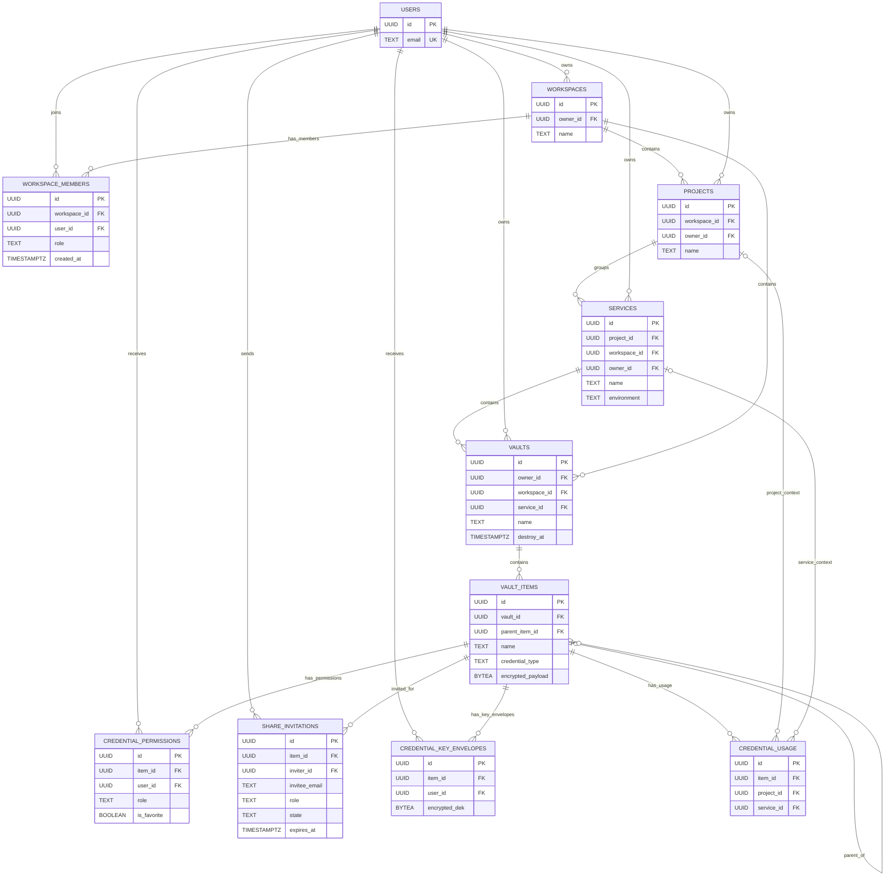
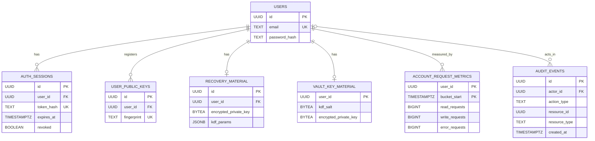
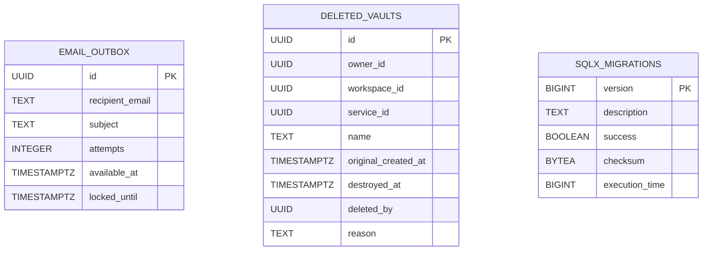

# Vaultnary ER Model

This document covers the complete relational model represented by the
application's current migrations, including product data, account/security
records, operational records, and vault-deletion history. The diagrams are split
by purpose to keep them readable.

Coverage: all 19 application tables plus the SQLx migration ledger. Entity boxes
show identifiers, relationships, and important attributes; the full column
catalog is in [`DBMS_SCHEMA_GUIDE.md`](./DBMS_SCHEMA_GUIDE.md).

## 1. Workspace, vault, and sharing data

## 2. Account, cryptographic, and audit data

## 3. Operational and deletion-history records

This section includes all three remaining records; none has foreign-key
relationships in the schema:

- `EMAIL_OUTBOX` stores recipient email text and queued message content. It does
  not reference a user row.
- `DELETED_VAULTS` stores immutable snapshots with no foreign keys, so deletion
  history remains after the vault or its parent records are removed.
- `SQLX_MIGRATIONS` represents the `_sqlx_migrations` table, the SQLx-managed
  migration ledger, not application business data.

## Relationship and constraint notes

- `||` means exactly one; `o|` means zero or one; `o{` means zero or many.
- `WORKSPACE_MEMBERS` resolves the many-to-many relationship between users and
  workspaces. `(workspace_id, user_id)` is unique.
- `CREDENTIAL_PERMISSIONS` resolves user access to credentials. `(item_id,
  user_id)` is unique, so there is at most one permission per user/credential.
- `RECOVERY_MATERIAL.user_id` is unique, and `VAULT_KEY_MATERIAL.user_id` is
  both its primary key and a foreign key; each is an optional one-to-one
  extension of a user. `ACCOUNT_REQUEST_METRICS` uses the composite primary key
  `(user_id, bucket_start)`, with `user_id` also referencing `USERS`.
- Each `CREDENTIAL_USAGE` row references a credential and at least one of a
  project or service. It can reference both.
- `VAULTS` has a composite foreign key `(service_id, workspace_id)` to
  `SERVICES (id, workspace_id)`, ensuring the selected service belongs to the
  same workspace.
- `VAULT_ITEMS.parent_item_id` is an optional self-reference. The database
  foreign key does not itself enforce that parent and child are in the same
  vault.
- `SHARE_INVITATIONS.invitee_email` is not a user foreign key; invitees may not
  have an account yet.
- `CREDENTIAL_KEY_ENVELOPES` references the recipient user and credential.
  `key_fingerprint` is descriptive text, not a foreign key to `USER_PUBLIC_KEYS`.
- `AUDIT_EVENTS.resource_id` is polymorphic metadata, not a foreign key. Its
  `resource_type` identifies the kind of resource. `actor_id` is optional and
  becomes NULL if the user is deleted.
- `VAULTS.destroy_at` is optional. The application worker schedules deletion;
  database triggers validate future schedule times and protect deletion history,
  but do not run the scheduler.
- `DELETED_VAULTS.owner_id`, `workspace_id`, `service_id`, and `deleted_by` are
  snapshots, not foreign keys.
- Encrypted payloads, private keys, and key envelopes contain ciphertext; the
  diagram does not imply that plaintext secrets are stored in the database.

The table definitions and migration-by-migration details are in
[`DBMS_SCHEMA_GUIDE.md`](./DBMS_SCHEMA_GUIDE.md). The consolidated migration
reference is [`database_schema.sql`](./database_schema.sql).
