# Vaultnary ER Model — Chen Notation

This is one Chen-style diagram for the complete database: all 19 application
tables plus the SQLx migration ledger.

- Rectangles are entities/tables.
- Diamonds are relationships.
- Oval-shaped labels are attributes. Primary keys are marked `(PK)`.
- Cardinalities are written on relationship lines.
- One outer rectangle encloses the complete diagram.

The diagram shows identifiers and representative attributes to keep it
readable. The complete column catalog is in
[`DBMS_SCHEMA_GUIDE.md`](./DBMS_SCHEMA_GUIDE.md).

```mermaid
%%{init: {"flowchart": {"nodeSpacing": 24, "rankSpacing": 34, "curve": "linear"}}}%%
flowchart LR
    subgraph ERD["Vaultnary complete database ER model"]
        U[USERS]:::entity
        U_ID([id PK]):::attribute --- U
        U_EMAIL([email UK]):::attribute --- U

        W[WORKSPACES]:::entity
        W_ID([id PK]):::attribute --- W
        W_NAME([name]):::attribute --- W

        WM[WORKSPACE_MEMBERS]:::entity
        WM_ID([id PK]):::attribute --- WM
        WM_ROLE([role]):::attribute --- WM
        WM_CREATED([created_at]):::attribute --- WM

        P[PROJECTS]:::entity
        P_ID([id PK]):::attribute --- P
        P_NAME([name]):::attribute --- P

        S[SERVICES]:::entity
        S_ID([id PK]):::attribute --- S
        S_NAME([name]):::attribute --- S
        S_ENV([environment]):::attribute --- S

        V[VAULTS]:::entity
        V_ID([id PK]):::attribute --- V
        V_NAME([name]):::attribute --- V
        V_DESTROY([destroy_at]):::attribute --- V

        I[VAULT_ITEMS]:::entity
        I_ID([id PK]):::attribute --- I
        I_NAME([name]):::attribute --- I
        I_TYPE([credential_type]):::attribute --- I
        I_CIPHER([encrypted_payload]):::attribute --- I

        CP[CREDENTIAL_PERMISSIONS]:::entity
        CP_ID([id PK]):::attribute --- CP
        CP_ROLE([role]):::attribute --- CP
        CP_FAVORITE([is_favorite]):::attribute --- CP

        SI[SHARE_INVITATIONS]:::entity
        SI_ID([id PK]):::attribute --- SI
        SI_EMAIL([invitee_email]):::attribute --- SI
        SI_ROLE([role]):::attribute --- SI
        SI_STATE([state]):::attribute --- SI

        KE[CREDENTIAL_KEY_ENVELOPES]:::entity
        KE_ID([id PK]):::attribute --- KE
        KE_CIPHER([encrypted_dek]):::attribute --- KE

        CU[CREDENTIAL_USAGE]:::entity
        CU_ID([id PK]):::attribute --- CU
        CU_ENV([environment]):::attribute --- CU

        R1{OWNS WORKSPACE}:::relationship
        U -- "1" --- R1
        R1 -- "N" --- W

        R2{HAS MEMBERSHIP}:::relationship
        U -- "1" --- R2
        R2 -- "N" --- WM
        R3{MEMBER OF}:::relationship
        W -- "1" --- R3
        R3 -- "N" --- WM

        R4{CONTAINS PROJECT}:::relationship
        W -- "1" --- R4
        R4 -- "N" --- P
        R5{OWNS PROJECT}:::relationship
        U -- "1" --- R5
        R5 -- "N" --- P

        R6{GROUPS SERVICE}:::relationship
        P -- "1" --- R6
        R6 -- "N" --- S
        R7{OWNS SERVICE}:::relationship
        U -- "1" --- R7
        R7 -- "N" --- S

        R8{CONTAINS VAULT}:::relationship
        S -- "1" --- R8
        R8 -- "N" --- V
        R9{OWNS VAULT}:::relationship
        U -- "1" --- R9
        R9 -- "N" --- V
        R10{SCOPES VAULT}:::relationship
        W -- "1" --- R10
        R10 -- "N" --- V

        R11{CONTAINS CREDENTIAL}:::relationship
        V -- "1" --- R11
        R11 -- "N" --- I
        R12{PARENT OF}:::relationship
        I -- "0..1" --- R12
        R12 -- "0..N" --- I

        R13{HAS PERMISSION}:::relationship
        I -- "1" --- R13
        R13 -- "N" --- CP
        R14{GRANTED TO}:::relationship
        U -- "1" --- R14
        R14 -- "N" --- CP

        R15{HAS INVITATION}:::relationship
        I -- "1" --- R15
        R15 -- "N" --- SI
        R16{SENT BY}:::relationship
        U -- "1" --- R16
        R16 -- "N" --- SI

        R17{HAS KEY ENVELOPE}:::relationship
        I -- "1" --- R17
        R17 -- "N" --- KE
        R18{KEY FOR USER}:::relationship
        U -- "1" --- R18
        R18 -- "N" --- KE

        R19{HAS USAGE}:::relationship
        I -- "1" --- R19
        R19 -- "N" --- CU
        R20{PROJECT CONTEXT}:::relationship
        P -- "0..1" --- R20
        R20 -- "0..N" --- CU
        R21{SERVICE CONTEXT}:::relationship
        S -- "0..1" --- R21
        R21 -- "0..N" --- CU
        AS[AUTH_SESSIONS]:::entity
        AS_ID([id PK]):::attribute --- AS
        AS_TOKEN([token_hash UK]):::attribute --- AS
        AS_EXPIRES([expires_at]):::attribute --- AS
        AS_REVOKED([revoked]):::attribute --- AS

        PK[USER_PUBLIC_KEYS]:::entity
        PK_ID([id PK]):::attribute --- PK
        PK_FP([fingerprint UK]):::attribute --- PK

        RM[RECOVERY_MATERIAL]:::entity
        RM_ID([id PK]):::attribute --- RM
        RM_USER([user_id unique FK]):::attribute --- RM
        RM_KEY([encrypted_private_key]):::attribute --- RM

        VKM[VAULT_KEY_MATERIAL]:::entity
        VKM_USER([user_id PK and FK]):::attribute --- VKM
        VKM_KEY([encrypted_private_key]):::attribute --- VKM

        ARM[ACCOUNT_REQUEST_METRICS]:::entity
        ARM_USER([user_id PK part, FK]):::attribute --- ARM
        ARM_BUCKET([bucket_start PK part]):::attribute --- ARM
        ARM_COUNTS([read / write / error counts]):::attribute --- ARM

        AE[AUDIT_EVENTS]:::entity
        AE_ID([id PK]):::attribute --- AE
        AE_ACTION([action_type]):::attribute --- AE
        AE_RESOURCE([resource_id and resource_type]):::attribute --- AE
        AE_CREATED([created_at]):::attribute --- AE

        R22{HAS SESSION}:::relationship
        U -- "1" --- R22
        R22 -- "N" --- AS
        R23{REGISTERS KEY}:::relationship
        U -- "1" --- R23
        R23 -- "N" --- PK
        R24{HAS RECOVERY DATA}:::relationship
        U -- "1" --- R24
        R24 -- "0..1" --- RM
        R25{HAS KEY MATERIAL}:::relationship
        U -- "1" --- R25
        R25 -- "0..1" --- VKM
        R26{HAS METRICS}:::relationship
        U -- "1" --- R26
        R26 -- "N" --- ARM
        R27{ACTS IN}:::relationship
        U -- "0..1" --- R27
        R27 -- "N" --- AE
        EO[EMAIL_OUTBOX]:::entity
        EO_ID([id PK]):::attribute --- EO
        EO_TO([recipient_email]):::attribute --- EO
        EO_SUBJECT([subject]):::attribute --- EO
        EO_RETRY([attempts / available_at / locked_until]):::attribute --- EO

        DV[DELETED_VAULTS]:::entity
        DV_ID([id PK]):::attribute --- DV
        DV_OWNER([owner_id snapshot]):::attribute --- DV
        DV_NAME([name]):::attribute --- DV
        DV_CREATED([original_created_at]):::attribute --- DV
        DV_DELETED([destroyed_at / reason]):::attribute --- DV

        MX[_sqlx_migrations]:::entity
        MX_VERSION([version PK]):::attribute --- MX
        MX_DESC([description]):::attribute --- MX
        MX_RESULT([success / checksum / execution_time]):::attribute --- MX
    end

    style ERD fill:#ffffff,stroke:#172033,stroke-width:3px
    classDef entity fill:#ffffff,stroke:#243b5a,stroke-width:1.5px,color:#172033
    classDef relationship fill:#eef3ff,stroke:#376de5,stroke-width:1.5px,color:#172033
    classDef attribute fill:#fffdf5,stroke:#9aa6b2,stroke-width:1px,color:#344054
```

## Important modeling notes

- All entities, relationships, and attributes are enclosed by one outer
  rectangular frame.
- The diagram includes all 19 application tables. `_sqlx_migrations` is also
  shown as SQLx's database migration ledger.
- `WORKSPACE_MEMBERS` and `CREDENTIAL_PERMISSIONS` are associative entities.
  `(workspace_id, user_id)` and `(item_id, user_id)` are unique pairs.
- `CREDENTIAL_USAGE` must reference a credential and at least one of a project
  or service; it may reference both.
- `VAULTS` uses `(service_id, workspace_id)` together to enforce that the
  service belongs to the same workspace.
- `SHARE_INVITATIONS.invitee_email` is not a user foreign key. A recipient may
  not have an account yet.
- `CREDENTIAL_KEY_ENVELOPES.key_fingerprint` is descriptive text, not a
  foreign key to `USER_PUBLIC_KEYS`.
- `AUDIT_EVENTS.resource_id` is polymorphic metadata, not a foreign key.
- `EMAIL_OUTBOX` has no user foreign key. `DELETED_VAULTS` stores snapshots
  without foreign keys so deletion history survives removal of parent records.
- `destroy_at` schedules work for the application worker. Database triggers
  validate the timestamp and protect deletion history; they do not execute the
  scheduled deletion.
- Encrypted payloads and key material shown here are ciphertext, not plaintext
  secrets.

See [`DBMS_SCHEMA_GUIDE.md`](./DBMS_SCHEMA_GUIDE.md) for all columns and
constraints, and [`database_schema.sql`](./database_schema.sql) for the
consolidated migration reference.
