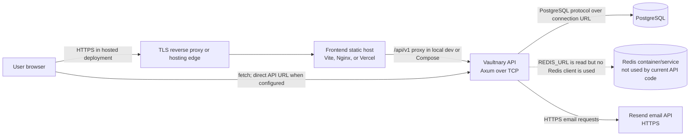
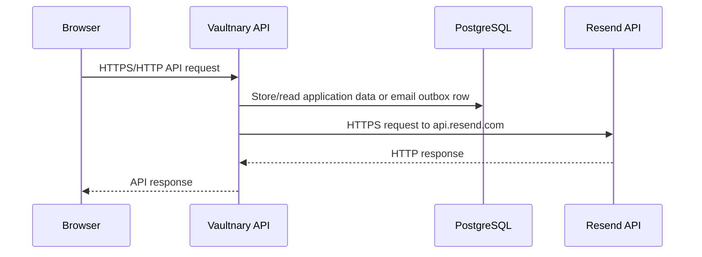

# 1. Network Architecture

## 1.1 Overview

Vaultnary is a browser application with an HTTP API. The browser downloads the frontend from a web host and sends API requests to the Rust/Axum service. The API connects to PostgreSQL and can call Resend over HTTPS to deliver email.

The repository defines two common layouts:

- **Development:** Vite serves the frontend and proxies `/api/v1` to the local API.
- **Docker Compose:** Nginx serves the frontend and proxies `/api/v1` to the API container.

The hosted manifests define an API and PostgreSQL on Render. The frontend has Vercel configuration, but the Render manifest does not declare a frontend service.

## 1.2 Component diagram

The path from a hosted browser to the API depends on the compiled frontend setting `VITE_API_BASE_URL`. When it is an absolute API URL, browser requests are cross-origin and require the API's CORS settings. When the browser uses the same origin and a reverse proxy forwards `/api/v1`, the browser sees a same-origin request.

## 1.3 Main request flows

### Loading the application and calling the API

1. The browser resolves the frontend hostname using the platform's DNS.
2. It establishes a connection to the hosting edge or web server. HTTPS/TLS is handled by that edge in the documented hosted layouts.
3. The web server returns the compiled frontend files.
4. The frontend calls `/api/v1/...` using the browser `fetch` API.
5. Depending on the environment, Vite or Nginx forwards the request to the API, or the browser connects to the configured API URL directly.
6. The API applies request middleware and handlers, then uses its PostgreSQL connection pool for application data.
7. The API returns an HTTP response. A request ID is included in the response for troubleshooting.

### Email delivery

Queued outbox messages are checked by a background task approximately every 10 seconds, in batches of up to 10. Failed queued deliveries are rescheduled with increasing delays, capped at one hour. The email integration uses Resend's HTTPS API, not an SMTP connection. See [email_outbox.rs](../apps/api/src/email_outbox.rs), [email.rs](../apps/api/src/email.rs), and [contact.rs](../apps/api/src/routes/contact.rs).

## 1.4 Trust and network boundaries

| Boundary | What crosses it | Notes |
|---|---|---|
| Browser to frontend host | HTML, JavaScript, CSS, static assets | TLS depends on the hosting provider or configured reverse proxy. |
| Browser to API | HTTP API requests, cookies, JSON, CSRF header | Production session cookies require HTTPS. Cross-origin requests need the configured CORS origin. |
| Frontend proxy to API | HTTP within local development or the Compose network | The proxy uses internal service names in Compose. |
| API to PostgreSQL | Database protocol over the configured connection | Local Compose uses an internal Docker service name; hosted encryption depends on the provider and connection URL. |
| API to Resend | HTTPS email API requests | The API key is supplied through environment configuration and must not be put in documentation. |
| Proxy to API | Forwarded client and scheme headers | Rate-limit IP selection trusts the first `X-Forwarded-For` value; configure the proxy boundary accordingly. |

The API binds to `0.0.0.0` on its configured port. This listens on all interfaces in its network namespace; whether it is reachable externally depends on container port publishing, firewalls, and hosting rules.

## 1.5 Source files

- [bootstrap.rs](../apps/api/src/bootstrap.rs) - API listener, middleware, CORS, database pool, and HTTP tracing.
- [config.rs](../apps/api/src/config.rs) - Required API environment variables.
- [http-client.ts](../apps/web/src/services/http-client.ts) - Browser API calls and credentials.
- [vite.config.ts](../apps/web/vite.config.ts) - Development API proxy.
- [compose.yaml](../deploy/compose.yaml) and [nginx.conf](../deploy/nginx.conf) - Container networking and reverse proxy.
- [render.yaml](../render.yaml) and [vercel.json](../apps/web/vercel.json) - Hosted deployment configuration.
