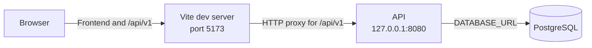
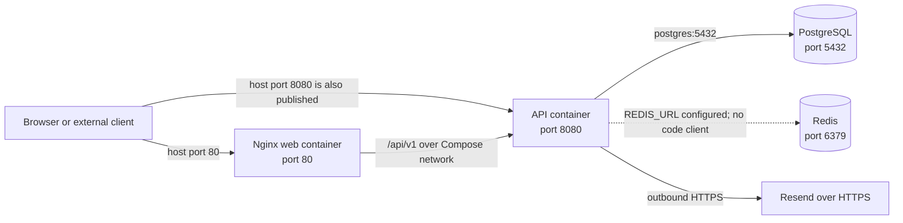

# 4. Deployment, Ports, and Configuration

## 4.1 Development layout

The Vite server proxies `/api/v1` to `VITE_API_BASE_URL`, defaulting to `http://127.0.0.1:8080`. The development CORS default is `http://localhost:5173`. See [vite.config.ts](../apps/web/vite.config.ts) and [bootstrap.rs](../apps/api/src/bootstrap.rs).

## 4.2 Docker Compose layout

The Compose file publishes ports 80, 8080, 5432, and 6379 on the Docker host. Docker's default published-port behavior may make them reachable beyond localhost, depending on host firewall and network configuration. Limit exposure to the intended network. In particular:

- Publishing API port 8080 allows clients to bypass the web Nginx proxy.
- Publishing database and Redis ports exposes development/infrastructure services on the host.
- The Nginx web container itself listens on HTTP port 80. Use a configured TLS-terminating edge for public HTTPS.
- The Compose Redis service is present, but the current API rate limiter is in memory and does not connect to it.

See [compose.yaml](../deploy/compose.yaml), [nginx.conf](../deploy/nginx.conf), and [Dockerfile](../apps/web/Dockerfile).

## 4.3 Hosted layout in checked-in manifests

`render.yaml` defines a Rust API service and a managed PostgreSQL database. The API port is set to `10000`; the manifest also lists `CORS_ORIGIN`, `FRONTEND_URL`, `SESSION_SECRET`, and `RESEND_API_KEY` configuration. It does not declare a Redis service or `REDIS_URL`. The Vercel configuration describes how to build and serve the frontend, but does not set `VITE_API_BASE_URL`.

The actual public frontend and API hostnames, TLS behavior, firewall rules, and provider-level environment variables must be confirmed in the deployment dashboards. A checked-in manifest alone does not establish that the current live deployment matches it.

## 4.4 Port and protocol reference

| Endpoint | Protocol | Configured port | Notes |
|---|---|---:|---|
| Vite development server | HTTP | 5173 | Local browser frontend. |
| Axum API | HTTP over TCP | `PORT`; 8080 in Compose, 10000 in `render.yaml` | Binds to `0.0.0.0` within its runtime. |
| Nginx frontend/API proxy | HTTP | 80 | Compose publication is `80:80`; TLS is expected in front of this container for public deployment. |
| Optional TLS reverse proxy | HTTPS over TCP | 443 | Example in `deploy/reverse-proxy/README.md`; not part of the API listener. |
| PostgreSQL | PostgreSQL protocol over TCP | 5432 in Compose | SQLx uses `DATABASE_URL`; hosted TLS depends on provider/URL configuration. |
| Redis | Redis protocol over TCP | 6379 in Compose | Service exists, but no current API client uses it. |
| Resend email endpoint | HTTPS | 443 | External API at `api.resend.com`. |
| p5.js and Vanta CDNs | HTTPS | 443 | Browser downloads scripts from cdnjs and jsDelivr for the landing background. |

## 4.5 Configuration and implementation discrepancies

These are source/configuration observations, not claims about settings that might be added manually in a provider dashboard.

| Area | Repository evidence | Operational meaning |
|---|---|---|
| Redis requirement vs use | `Config::from_env()` requires `REDIS_URL`, but no API source creates a Redis client or reads the stored config value. The rate limiter uses `InMemoryStore`. | Redis is not currently the rate-limit backend. The in-memory limit is per process and is not shared across instances. |
| Render Redis environment | `render.yaml` does not declare `REDIS_URL`. | If no dashboard-level variable supplies it, API startup fails when `Config::from_env()` requires it. |
| Email provider configuration | `.env.example` and Compose list SMTP variables; API email code uses Resend HTTPS. `render.yaml` declares `RESEND_API_KEY`, while Compose does not. | SMTP settings alone do not enable the current email implementation. Supply the Resend key securely where email is required. |
| Docker CSP vs frontend | Docker Nginx CSP only permits same-origin scripts and connections, but the landing page loads scripts from cdnjs and jsDelivr. A direct cross-origin API URL is also outside `connect-src 'self'`. | Those requests are blocked by that CSP in the Docker deployment unless the policy and deployment routing are aligned. |
| API direct exposure | Compose publishes `8080:8080` in addition to the web proxy on port 80. | API requests can bypass Nginx on hosts where port 8080 is reachable; forwarded-header trust should account for this. |
| Inbound TLS | The API listens for HTTP on its configured port; Compose Nginx listens on port 80. The reverse-proxy guide expects TLS termination in front. | Verify HTTPS is actually enabled at the public edge; the internal HTTP listener is not evidence of encryption from the user's browser. |

Related files: [config.rs](../apps/api/src/config.rs), [rate_limit.rs](../apps/api/src/middleware/rate_limit.rs), [render.yaml](../render.yaml), [.env.example](../.env.example), [compose.yaml](../deploy/compose.yaml), and [nginx.conf](../deploy/nginx.conf).

## 4.6 Deployment checklist

- Set `DATABASE_URL`, `PORT`, `SESSION_SECRET`, and `REDIS_URL` as required by the API configuration; do not put secret values in source or documentation.
- Set `CORS_ORIGIN` to the exact browser frontend origin if the frontend and API use different origins.
- Set `FRONTEND_URL` to the correct public frontend URL for email links.
- Configure the Resend API key securely when email delivery is required; SMTP variables do not substitute for it.
- Terminate TLS at the public edge and verify the external browser-to-application connection uses HTTPS.
- Decide whether the API should be reachable directly or only through a trusted proxy. Restrict published ports and sanitize forwarded headers.
- Align Content-Security-Policy with the actual frontend script CDNs and API origin.
- Do not assume Redis is serving rate-limit data until a Redis client is implemented and the runtime is verified.
